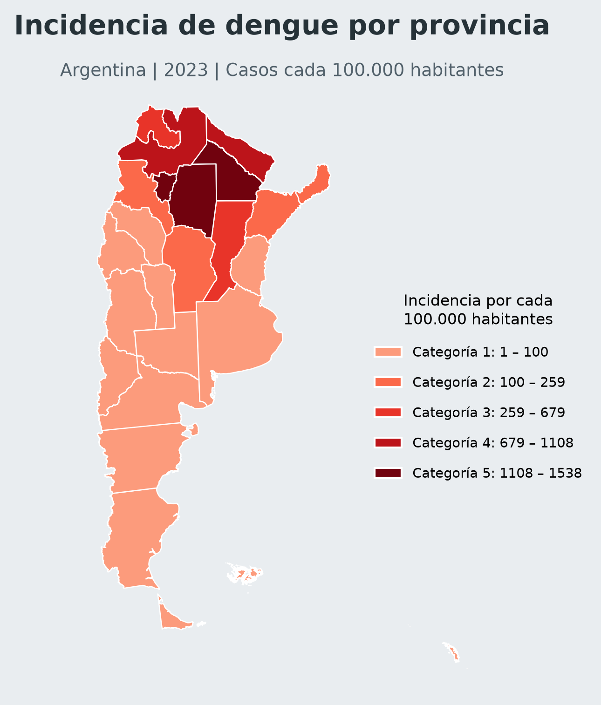
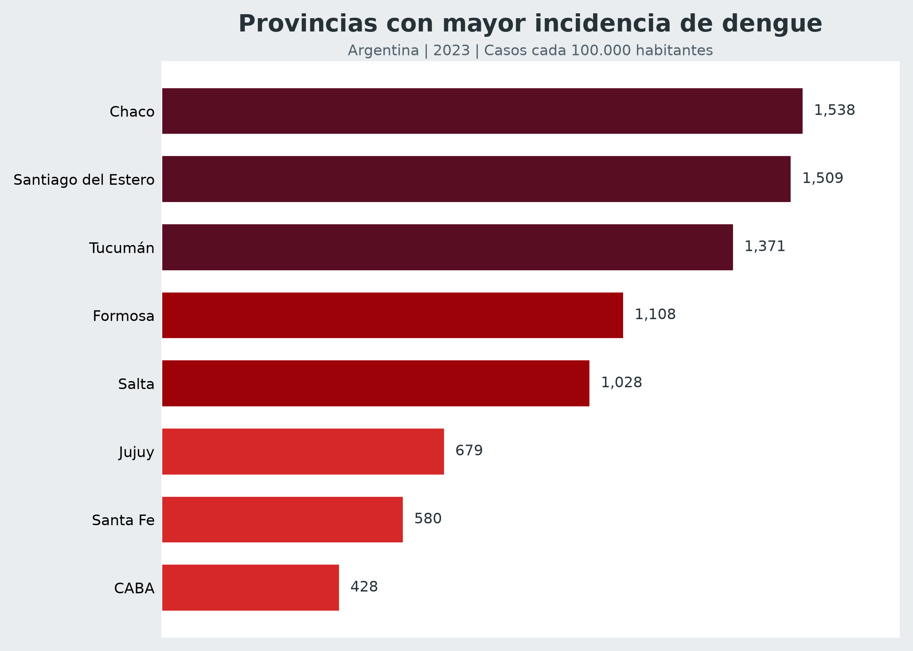
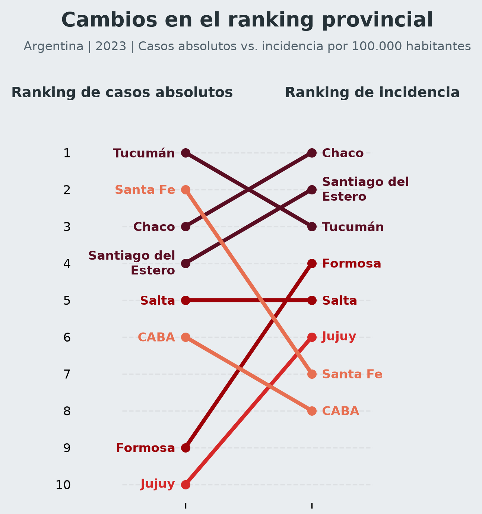

# Análisis espacial del dengue en Argentina — 2023

**Spatial analysis of dengue incidence in Argentina during 2023**

Un proyecto de análisis epidemiológico y geoespacial que explora la distribución territorial del dengue en Argentina durante 2023, comparando casos absolutos e incidencia poblacional mediante Python, visualizaciones cartográficas y storytelling.

---

## 1. Descripción del proyecto

Este proyecto analiza la distribución territorial de los casos de dengue en las 24 jurisdicciones de Argentina durante el año calendario 2023.

El objetivo es explorar si las provincias que concentran la mayor cantidad de casos son también aquellas que presentan la mayor incidencia en relación con su población.

Para responder esta pregunta, se integran registros epidemiológicos, estimaciones demográficas e información geográfica. El análisis combina procesamiento de datos, análisis espacial, visualización y comunicación de resultados.

El proyecto no se limita a producir gráficos: busca construir una narrativa basada en datos que permita comprender las diferencias territoriales y comunicar los principales hallazgos de manera clara y accesible.

## 2. Pregunta de investigación

**¿La distribución territorial de los casos de dengue refleja también dónde fue mayor la carga epidemiológica relativa?**

Para abordar esta pregunta se comparan dos indicadores:

- **Casos absolutos:** cantidad de casos registrados en cada provincia.
- **Incidencia por cada 100.000 habitantes:** relación entre los casos registrados y la población estimada de cada provincia.

Esta distinción es fundamental: una provincia puede presentar muchos casos debido a su tamaño poblacional, pero no necesariamente tener la mayor incidencia.

## 3. Fuentes de datos

El proyecto integra tres fuentes principales:

| Fuente | Información utilizada |
|---|---|
| Ministerio de Salud de la Nación | Registros de vigilancia epidemiológica de dengue y zika |
| INDEC | Estimaciones y proyecciones de población provincial para 2023 |
| Georef Argentina | Geometrías y límites geográficos de las provincias |

El período de estudio comprende las semanas epidemiológicas 1 a 52 del año calendario 2023. No debe confundirse con el total de la temporada epidemiológica 2023-2024.

Los archivos originales se encuentran en `data/raw/` y los conjuntos preparados para el análisis en `data/processed/`.

## 4. Metodología y flujo de trabajo

El proyecto se desarrolla en dos notebooks consecutivos.

### Notebook 01 — Exploración y preparación de datos

`notebooks/01_exploracion_geoespacial.ipynb`

Esta etapa comprende:

1. Carga y exploración de los registros epidemiológicos.
2. Selección de los casos de dengue correspondientes a 2023.
3. Evaluación de duplicados, valores faltantes y consistencia de los registros.
4. Agregación de casos por provincia.
5. Integración con las estimaciones de población del INDEC.
6. Cálculo de la incidencia por cada 100.000 habitantes.
7. Integración de los datos con las geometrías provinciales.
8. Exportación de los conjuntos de datos procesados.

**Productos generados:**
- `data/processed/dengue_analisis_provincial_2023.csv`
- `data/processed/dengue_provincias_2023.geojson`

### Notebook 02 — Análisis espacial y storytelling

`notebooks/02_analisis_espacial_y_storytelling.ipynb`

Esta etapa transforma los datos procesados en visualizaciones orientadas a responder la pregunta de investigación.

Incluye:

1. Carga y validación de los datos geoespaciales.
2. Elaboración de un mapa coroplético de incidencia provincial.
3. Clasificación de los valores mediante Jenks Natural Breaks en cinco categorías.
4. Identificación de las ocho provincias con mayor incidencia.
5. Comparación de los rankings de casos absolutos e incidencia.
6. Exportación de las figuras en formatos PNG y PDF.

## 5. Enfoque de Data Storytelling

El storytelling se construyó a partir de una pregunta central: **¿cambia nuestra interpretación de la distribución del dengue cuando dejamos de observar solamente la cantidad de casos y consideramos también el tamaño de la población?**

La narrativa sigue una secuencia de comunicación:

**1. Contexto territorial**

Se presenta la distribución espacial de la incidencia para reconocer las diferencias entre provincias y observar la concentración geográfica de los valores más elevados.

**2. Contraste entre indicadores**

Se compara el ranking de casos absolutos con el ranking de incidencia. Esta comparación permite identificar provincias cuya posición cambia significativamente según el indicador utilizado.

**3. Identificación de patrones**

Se destacan las provincias del norte argentino, que concentran los valores más elevados de incidencia, y se contrastan con jurisdicciones que presentan muchos casos absolutos pero una incidencia relativamente menor.

**4. Interpretación y conclusiones**

Se comunica por qué los indicadores relativos aportan una perspectiva complementaria a los recuentos absolutos y se explicitan los límites de la información disponible.

La intención es que cada visualización cumpla una función dentro de la historia, en lugar de presentar gráficos aislados sin una pregunta que los conecte.

## 6. Visualizaciones principales

Las visualizaciones se diseñaron con una identidad gráfica común, utilizando una paleta de tonos rojos y bordó, fondos neutros y una jerarquía visual consistente.

### Mapa de incidencia provincial

Permite identificar la distribución territorial de la incidencia de dengue por cada 100.000 habitantes.



### Ranking de las ocho provincias con mayor incidencia

Destaca las jurisdicciones con mayor carga epidemiológica relativa.



### Comparación entre casos absolutos e incidencia

Muestra cómo cambia la posición de las provincias cuando se consideran ambos indicadores.



Las figuras también se encuentran disponibles en formato PDF dentro de `outputs/figures/`.

## 7. Principales hallazgos

El análisis evidencia que la distribución de casos absolutos no coincide completamente con la distribución de la incidencia.

Algunos resultados destacados:

- **Tucumán** presentó el mayor número de casos absolutos, con 24.172 registros.
- **Chaco** presentó la incidencia más elevada, con 1.537,63 casos por cada 100.000 habitantes.
- **Santiago del Estero** ocupó el segundo lugar en incidencia, con 1.509,42 casos por cada 100.000 habitantes.
- Las cinco provincias con mayor incidencia fueron Chaco, Santiago del Estero, Tucumán, Formosa y Salta.
- Buenos Aires presentó una cantidad importante de casos absolutos, pero una incidencia considerablemente menor en comparación con las provincias del norte.

El principal hallazgo es que observar únicamente la cantidad de casos puede ofrecer una interpretación incompleta de la distribución territorial del fenómeno. La incidencia permite incorporar el contexto poblacional y realizar comparaciones más significativas entre jurisdicciones.

## 8. Presentación final

Como etapa de comunicación del proyecto, se desarrolló una presentación que integra el análisis y sus principales resultados mediante una narrativa visual.

La presentación está organizada en seis secciones:

1. **Portada:** presentación del tema y la pregunta de investigación.
2. **Datos y metodología:** fuentes utilizadas y proceso de integración.
3. **Distribución territorial:** mapa de incidencia provincial.
4. **Casos absolutos vs. incidencia:** comparación de indicadores y rankings.
5. **Hallazgos e interpretación:** patrones territoriales identificados.
6. **Conclusiones y limitaciones:** síntesis de resultados y posibles líneas futuras.

Los archivos PowerPoint y PDF se encuentran en la carpeta [`presentation/`](presentation/).

## 9. Cómo ejecutar el proyecto

### Requisitos previos

- Python 3.11 o superior.
- JupyterLab.
- Los archivos de datos incluidos en el repositorio.

### Paso 1 — Clonar el repositorio

```bash
git clone https://github.com/luisina14BIO/dengue-spatial-storytelling.git
cd dengue-spatial-storytelling
```

### Paso 2 — Crear un entorno virtual

Con Conda:

```bash
conda create -n dengue_spatial python=3.11
conda activate dengue_spatial
```

### Paso 3 — Instalar las dependencias

Desde la carpeta raíz del proyecto:

```bash
pip install -r requirements.txt
```

### Paso 4 — Iniciar JupyterLab

Desde la carpeta raíz, ingresar a `notebooks`:

```bash
cd notebooks
jupyter lab
```

### Paso 5 — Ejecutar los notebooks

Ejecutar los notebooks en el siguiente orden:

1. `01_exploracion_geoespacial.ipynb`
2. `02_analisis_espacial_y_storytelling.ipynb`

El primer notebook prepara y exporta los datos procesados que utiliza el segundo.

**Importante:** conservar la estructura original de carpetas, ya que los notebooks utilizan rutas relativas para acceder a los archivos.

## 10. Estructura del repositorio

```text
dengue-spatial-storytelling/
│
├── data/
│   ├── raw/
│   └── processed/
│
├── notebooks/
│   ├── 01_exploracion_geoespacial.ipynb
│   └── 02_analisis_espacial_y_storytelling.ipynb
│
├── outputs/
│   └── figures/
│       ├── mapa_incidencia_dengue_2023.png
│       ├── mapa_incidencia_dengue_2023.pdf
│       ├── top8_incidencia_dengue_2023.png
│       ├── top8_incidencia_dengue_2023.pdf
│       ├── comparacion_ranking_dengue_2023.png
│       └── comparacion_ranking_dengue_2023.pdf
│
├── presentation/
│   ├── Presentación PowerPoint
│   └── Presentación PDF
│
├── .gitignore
├── requirements.txt
└── README.md
```

## 11. Tecnologías utilizadas

- **Python 3.11:** lenguaje de programación.
- **Pandas y NumPy:** manipulación y análisis de datos.
- **GeoPandas:** procesamiento y análisis geoespacial.
- **Matplotlib:** visualización de datos.
- **Mapclassify:** clasificación estadística para mapas coropléticos.
- **JupyterLab:** desarrollo y documentación del análisis.

## 12. Limitaciones

Este trabajo tiene un alcance exploratorio y descriptivo.

- El análisis se limita al año calendario 2023 y no representa la totalidad de la temporada epidemiológica 2023-2024.
- Los registros con provincia de residencia desconocida fueron excluidos del análisis provincial.
- Se conservaron determinados registros repetidos cuando no fue posible establecer con certeza que fueran errores de carga.
- Se identificó una diferencia entre el total de registros provinciales disponibles y el total informado en el Boletín Epidemiológico Nacional. Esta discrepancia no pudo reconciliarse con la información disponible.
- La incidencia se calculó utilizando estimaciones de población provincial para 2023.
- No se incorporaron variables climáticas, ambientales, socioeconómicas ni entomológicas. Por lo tanto, los resultados no permiten establecer relaciones causales ni explicar los factores que originaron los patrones observados.
- La clasificación Jenks es una herramienta estadística de representación y no una categorización oficial de riesgo epidemiológico.

## 13. Posibles líneas de investigación futuras

- Incorporar variables climáticas y ambientales para estudiar su relación con la distribución territorial del dengue.
- Analizar la evolución temporal de los casos por provincia y semana epidemiológica.
- Explorar indicadores socioeconómicos y demográficos asociados con la distribución de la incidencia.
- Desarrollar modelos predictivos de evolución y distribución de casos.
- Ampliar el análisis a otras temporadas epidemiológicas para identificar patrones espaciales persistentes.

---

**Proyecto desarrollado como parte de Data Science II**, con foco en análisis de datos epidemiológicos, análisis geoespacial y Data Storytelling.
